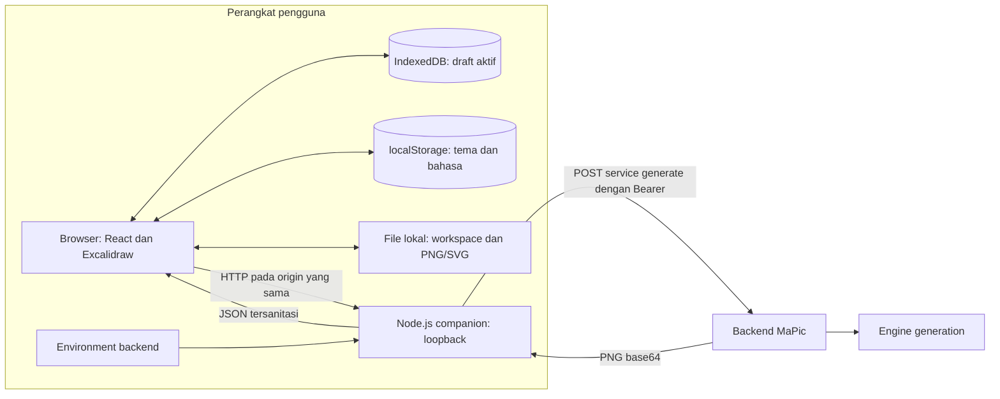
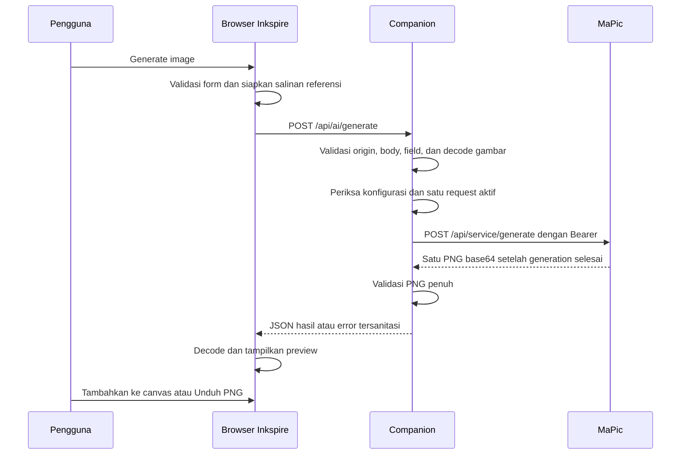

# Architecture

Inkspire adalah aplikasi canvas pribadi dengan penyimpanan lokal dan generation gambar melalui MaPic. Browser menjalankan editor; companion Node.js menyajikan aplikasi dan meneruskan request AI dengan kredensial backend.

Dokumen ini menjelaskan implementasi saat ini. Panduan penggunaan dan pengembangan tersedia di [Workflow](WORKFLOW.md); detail payload ada di [kontrak MaPic](docs/mapic-contract.md).

## Gambaran sistem



Companion bind hanya ke `127.0.0.1`, dengan port default `4173`. Browser dan API Inkspire memakai satu origin. Pengguna lain menjalankan companion pada perangkatnya sendiri; implementasi ini belum menyediakan layanan web publik dengan akun pengguna.

MaPic merupakan layanan terpisah yang dapat diakses melalui jaringan. Token service hanya berada di environment companion. Browser tidak menerima token atau menentukan URL downstream melalui request.

## Stack dan struktur

Versi dependency dipin di [package.json](package.json) dan [package-lock.json](package-lock.json). Runtime proyek adalah Node.js `24.x`.

| Area | Teknologi | Tanggung jawab |
| --- | --- | --- |
| Antarmuka | React, TypeScript, CSS, Tabler Icons | Shell, panel AI, dialog, bahasa, tema |
| Canvas | Excalidraw | Elemen, gambar, seleksi, konektor, viewport, undo/redo |
| Penyimpanan | IndexedDB dan localStorage native | Draft serta preferensi lokal |
| Companion | Node.js HTTP/HTTPS native | Penyajian app, validasi, transport MaPic |
| Decode gambar backend | Sharp | Validasi format, dimensi, dan decode penuh |
| Development/build | Vite, TypeScript, tsx | Middleware dev dan output production |
| Pengujian | Vitest, fake-indexeddb, Playwright | Unit, HTTP, persistence, dan E2E |

```text
src/
  App.tsx                  Koordinasi workspace, AI, panel, dan lifecycle
  main.tsx                 Entry React dan provider bahasa
  app.css                  Token visual, layout, outline, dan animasi
  features/
    editor/                Adapter Excalidraw, insertion PNG, tema, bahasa
    workspace/             Draft, autosave, file, import/export, dialog
    ai/                    Kontrak, request, referensi, state, panel AI
server/
  index.ts                 Startup dan shutdown companion
  config.ts                Konfigurasi environment saat startup
  app.ts                   Routing API, origin, dan guard request aktif
  request.ts               Validasi akses, body, dan field generation
  images.ts                Validasi gambar referensi dan hasil
  mapic.ts                 Transport service MaPic dan sanitasi error
  web.ts                   Middleware Vite atau penyajian dist
scripts/
  copy-editor-assets.mjs    Salinan font, worker, dan notice dependency
public/                    Font/aset lokal, notice, dan preview tema
tests/                     Unit/HTTP, fixtures, mock MaPic, dan E2E
docs/                      Kontrak, evidence verifikasi, dan plan historis
```

## Ownership state dan editor

`App` memiliki `useWorkspace` dan `useGeneration`. Panel AI hanya menampilkan state generation, sehingga menutup panel mempertahankan prompt, referensi, request aktif, dan preview selama halaman tetap terbuka.

Excalidraw tetap menjadi pemilik perilaku drawing dan history. Adapter editor meneruskan perubahan scene serta aset ke workspace. Menambahkan PNG memakai API native dengan capture history langsung, sehingga insertion dapat di-undo.

Pergantian bahasa dan tema tidak meremount editor. Bahasa `id`/`en` diterapkan pada shell dan label editor. Tema mengikuti OS atau override lokal; ikon Ink memakai View Transition organik 650 ms. Reduced motion atau browser tanpa API tersebut mengganti tema langsung.

## Penyimpanan dan identitas

| Data | Lokasi | Perilaku |
| --- | --- | --- |
| Draft aktif dan gambar pada canvas | IndexedDB: database `inkspire`, store `workspace`, key `active` | Dipulihkan saat app dibuka kembali |
| Tema | localStorage: `inkspire-theme` | Preferensi system/light/dark |
| Bahasa | localStorage: `inkspire-language` | Preferensi Indonesia/English |
| Prompt, referensi AI, request, preview | State React dalam memori | Tidak dipulihkan setelah reload |
| Workspace `.excalidraw` | File unduhan pengguna | Snapshot editable dengan aset gambar |
| PNG/SVG | File unduhan pengguna | Gambar hasil AI atau export canvas |
| Token MaPic | Environment companion atau `.env` lokal | Tidak masuk scene, IndexedDB, atau bundle browser |

Draft berisi `schemaVersion`, `workspaceId`, `revision`, `name`, `sceneJSON`, viewport, dan waktu pembaruan. Scene memakai format native Excalidraw dengan aset gambar tertanam. Satu draft aktif disimpan; belum ada daftar banyak workspace atau arsip hasil AI.

Pemisahan storage mengikuti profil browser dan origin, termasuk scheme, hostname, serta port. `localhost:4173` dan `127.0.0.1:4173` memiliki storage berbeda. Dua pengguna pada profil browser dan origin yang sama memakai draft yang sama. Beberapa tab juga berbagi storage; aplikasi belum menyediakan resolusi konflik antartab.

Autosave menggunakan debounce 250 ms dan antrean penulisan serial. Snapshot disalin sebelum dijadwalkan. Epoch pergantian workspace serta revision mencegah penulisan terjadwal lama dan status save lama mengambil alih workspace baru. Status tersimpan baru diberikan setelah transaksi IndexedDB selesai.

Restore mendahului mount editor. Record yang gagal dibaca atau ditulis tidak dihapus otomatis. Recovery menyediakan tindakan eksplisit. Menghapus data browser atau mengganti origin dapat menghilangkan akses draft; file workspace merupakan cadangan yang dapat dipindahkan.

## Jalur generation



State AI berjalan melalui `idle`, `preparing`, `pending`, kemudian `success` atau `error`. Request blocking menghasilkan satu PNG. UI menampilkan waktu tunggu, tanpa progress persen, polling job, atau cancel GPU.

Referensi dari upload atau seleksi canvas diproses menjadi salinan PNG/JPEG sesuai batas ukuran. Aset sumber tetap utuh. Companion memvalidasi ulang input dan decode gambar penuh sebelum mengirimnya ke MaPic.

Preview menjadi aset workspace setelah pengguna memilih **Tambahkan ke canvas**. ID file PNG berasal dari SHA-256 isi gambar. Insertion mempertahankan rasio dan memeriksa identitas workspace setelah pekerjaan asynchronous; hasil dari workspace lain memerlukan konfirmasi target.

MaPic service tidak membuat history atau upload Supabase untuk request Inkspire. Aplikasi MaPic secara keseluruhan tetap memiliki kebutuhan konfigurasi tersendiri, termasuk konfigurasi startup Supabase; hal itu berada di luar repository ini.

## Batas dan failure handling

| Batas | Nilai |
| --- | --- |
| Prompt | Nonempty setelah trim; maksimal 2000 Unicode code points |
| Referensi | Maksimal 10 PNG/JPEG single-frame |
| Body request dan respons downstream | Maksimal 32 MiB masing-masing |
| Satu referensi | Maksimal 2 MiB decoded dan 2.800.000 karakter base64 |
| Dimensi referensi | Maksimal sisi 2048 px dan 4.194.304 piksel |
| Steps / CFG / resolusi | 20–75 / 1–3 / 1024 |
| Default generation | 40 steps, CFG 1, resolusi 1024 |
| Output PNG | Single-frame; maksimal 16.777.216 piksel decoded |
| Import workspace | Maksimal 64 MiB |
| Timeout MaPic / deadline companion | 3.600.000 ms / 3.660.000 ms |

Companion mempertahankan guard satu request aktif sampai downstream selesai atau deadline, termasuk ketika browser disconnect. MaPic memiliki antrean gabungan dan lock inference sendiri; Inkspire tidak menambahkan antrean kedua.

Timeout, disconnect, atau hasil downstream tidak valid dapat menghasilkan `outcomeUnknown: true`. Percobaan baru memerlukan konfirmasi di UI; aplikasi tidak melakukan retry otomatis. Menutup panel atau memutus koneksi tidak membatalkan inference GPU. Reload juga tidak memulihkan request atau preview.

Error downstream tidak diteruskan mentah. Respons lokal membawa `code`, pesan aplikasi, `outcomeUnknown`, dan `field` opsional. Detail kontrak dan pemetaan HTTP tersedia di [kontrak MaPic](docs/mapic-contract.md).

## Boundary keamanan dan penyajian aset

- API generation memeriksa Host/origin kanonis, method POST, JSON content type, `X-Inkspire-Client: 1`, serta cross-site request.
- URL MaPic dan Bearer berasal dari konfigurasi backend; field tambahan dari browser ditolak. Redirect downstream tidak diikuti.
- Serving memblokir path sensitif dan traversal. Production hanya menyajikan file dalam `dist`, dengan pemeriksaan realpath untuk mencegah symlink keluar dari root.
- `.env` dan file backend tidak disajikan oleh web server. `.gitignore` mengecualikan kredensial, folder sementara, artefak lokal, dan output build.
- Font UI/editor serta worker disajikan lokal. Worker font native memiliki graph terpisah agar tidak mengimpor entry UI yang membutuhkan `document`.

Validasi localhost membatasi akses request; aplikasi belum menyediakan autentikasi pengguna, kontrol akses berbasis akun, atau enkripsi storage browser. HTTP menuju MaPic juga tidak mengenkripsi Bearer; gunakan HTTPS atau transport terlindungi sesuai lingkungan jaringan.

## Development, production, dan pengujian

Pada development, companion memasang Vite middleware dan HMR pada HTTP server yang sama. Pada production, Vite menghasilkan `dist/`, sedangkan TypeScript menghasilkan `dist-server/`; companion compiled menyajikan frontend dan API.

`dev` dan `build` menjalankan penyalinan aset editor serta notice dependency. Tidak ada service worker atau paket desktop pada implementasi sekarang.

Unit/HTTP menggunakan Vitest dan fake-indexeddb. E2E Chromium memakai companion `4183` dan mock MaPic `4184`, dengan token sentinel khusus tes. Harness tidak membaca `.env` operator dan tidak memiliki fallback ke GPU nyata. Mode production menjalankan entry companion hasil compilation dengan environment tes eksplisit.

T2I nyata telah berhasil pada 8 Oktober 2026; I2I memiliki verifikasi melalui mock. Evidence dan batas cakupan tersedia di [verifikasi](docs/verification.md). Pengujian browser saat ini mencakup Chromium; fallback tema tersedia untuk browser tanpa View Transition API.

## Batas pengembangan saat ini

MVP belum menyediakan akun, collaboration, sinkronisasi cloud, gallery/history AI, banyak draft aktif, recovery generation lintas reload, endpoint job/cancel, atau MCP. Penambahan layanan publik dan penyimpanan per akun memerlukan desain identitas, akses, serta persistence server tersendiri.

Source Inkspire berlisensi [Apache-2.0](LICENSE). Komponen pihak ketiga tetap mengikuti lisensinya masing-masing; notice dependency dan font tersedia di [Third-party notices](THIRD_PARTY_NOTICES.md).
