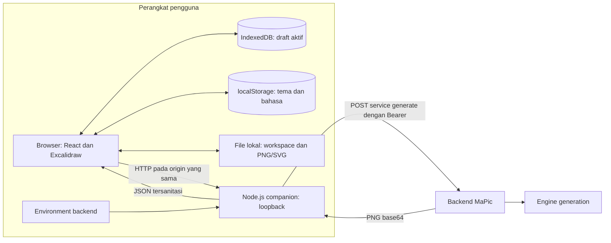
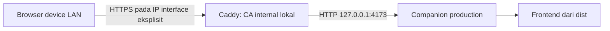
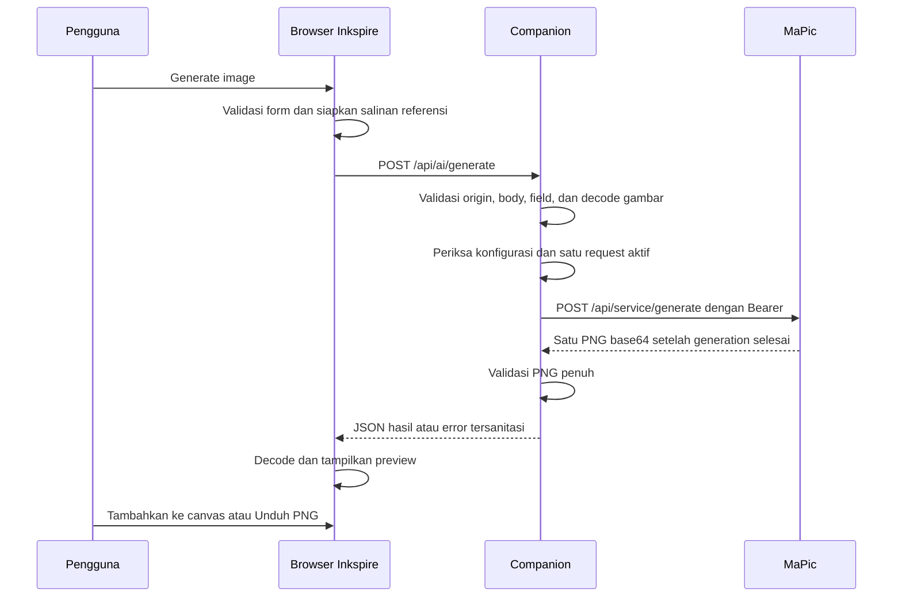

# Architecture

Inkspire adalah aplikasi canvas pribadi dengan penyimpanan lokal dan generation gambar melalui MaPic. Browser menjalankan editor; companion Node.js menyajikan aplikasi dan meneruskan request AI dengan kredensial backend.

Dokumen ini menjelaskan implementasi saat ini. Panduan penggunaan dan pengembangan tersedia di [Workflow](WORKFLOW.md); detail payload ada di [kontrak MaPic](docs/mapic-contract.md).

## Gambaran sistem



Companion bind hanya ke `127.0.0.1`, dengan port default `4173`. Browser dan API Inkspire memakai satu origin. Pengguna lain menjalankan companion pada perangkatnya sendiri; implementasi ini belum menyediakan layanan web publik dengan akun pengguna.

Mode LAN opsional menambah satu proxy HTTPS di depan companion tanpa mengubahnya:



`INKSPIRE_PUBLIC_ORIGIN` kosong berarti default localhost. Saat diisi, origin tersebut menjadi canonical origin tunggal: companion tetap bind loopback, Guard Host/Origin memakai origin itu, dan Caddy meneruskan Host serta Origin browser apa adanya ke upstream. Admin API Caddy dimatikan, auto-HTTPS redirect dimatikan, dan hanya IP LAN eksplisit yang di-bind; tidak ada wildcard, alias localhost, atau listener tambahan. Config dan PKI lokal tinggal pada `.inkspire-lan/` yang dikecualikan dari Git, di luar `dist`/`public`, dengan folder `0700` dan file `0600` pada POSIX. Child Caddy menerima environment whitelist tanpa `MAPIC_BASE_URL` maupun `MAPIC_SERVICE_TOKEN`.

MaPic merupakan layanan terpisah yang dapat diakses melalui jaringan. Token service hanya berada di environment companion. Browser tidak menerima token atau menentukan URL downstream melalui request.

## Stack dan struktur

Versi dependency dipin di [package.json](package.json) dan [package-lock.json](package-lock.json). Runtime proyek adalah Node.js `24.x`.

| Area | Teknologi | Tanggung jawab |
| --- | --- | --- |
| Antarmuka | React, TypeScript, CSS, Tabler Icons | Shell, panel AI, dialog, bahasa, tema |
| Canvas | Excalidraw | Elemen, gambar, seleksi, konektor, viewport, undo/redo |
| Flowchart lokal | Mermaid dan `@excalidraw/mermaid-to-excalidraw` | Rendering subset flowchart menjadi elemen native, berjalan di browser |
| Penyimpanan | IndexedDB dan localStorage native | Draft serta preferensi lokal |
| Companion | Node.js HTTP/HTTPS native | Penyajian app, validasi, transport MaPic |
| Decode gambar backend | Sharp | Validasi format, dimensi, dan decode penuh |
| Development/build | Vite, TypeScript, tsx | Middleware dev dan output production |
| Pengujian | Vitest, fake-indexeddb, Playwright | Unit, HTTP, persistence, dan E2E |

```text
src/
  App.tsx                  Koordinasi workspace, AI, panel, dan lifecycle
  main.tsx                 Entry React dan provider bahasa
  app.css                  Token visual, layout, outline, dan animasi
  features/
    editor/                Adapter Excalidraw, insertion PNG, tema, bahasa
    flowchart/             Parser teks/Mermaid, graph, converter, dialog, insertion
    workspace/             Draft, autosave, file, import/export, dialog
    ai/                    Kontrak, request, referensi, state, panel AI
server/
  index.ts                 Startup dan shutdown companion
  config.ts                Konfigurasi environment saat startup
  app.ts                   Routing API, origin, dan guard request aktif
  request.ts               Validasi akses, body, dan field generation
  images.ts                Validasi gambar referensi dan hasil
  mapic.ts                 Transport service MaPic dan sanitasi error
  web.ts                   Middleware Vite atau penyajian dist
scripts/
  copy-editor-assets.mjs    Salinan font, worker, dan notice dependency
public/                    Font/aset lokal, notice, dan preview tema
tests/                     Unit/HTTP, fixtures, mock MaPic, dan E2E
docs/                      Kontrak, evidence verifikasi, dan plan historis
```

## Ownership state dan editor

`App` memiliki `useWorkspace`, `useGeneration`, dan `useFlowchart`. Panel AI hanya menampilkan state generation, sehingga menutup panel mempertahankan prompt, referensi, request aktif, dan preview selama halaman tetap terbuka. Dialog Flowchart juga hanya view: input, tab, arah, preview, dan token invalidasi dimiliki controller di `App`.

Excalidraw tetap menjadi pemilik perilaku drawing dan history. Adapter editor meneruskan perubahan scene serta aset ke workspace. Menambahkan PNG memakai API native dengan capture history langsung, sehingga insertion dapat di-undo.

Pergantian bahasa dan tema tidak meremount editor. Bahasa `id`/`en` diterapkan pada shell dan label editor. Tema mengikuti OS atau override lokal; ikon Ink memakai View Transition organik 650 ms. Reduced motion atau browser tanpa API tersebut mengganti tema langsung.

## Penyimpanan dan identitas

| Data | Lokasi | Perilaku |
| --- | --- | --- |
| Draft aktif dan gambar pada canvas | IndexedDB: database `inkspire`, store `workspace`, key `active` | Dipulihkan saat app dibuka kembali |
| Tema | localStorage: `inkspire-theme` | Preferensi system/light/dark |
| Bahasa | localStorage: `inkspire-language` | Preferensi Indonesia/English |
| Prompt, referensi AI, request, preview | State React dalam memori | Tidak dipulihkan setelah reload |
| Workspace `.excalidraw` | File unduhan pengguna | Snapshot editable dengan aset gambar |
| PNG/SVG | File unduhan pengguna | Gambar hasil AI atau export canvas |
| Token MaPic | Environment companion atau `.env` lokal | Tidak masuk scene, IndexedDB, atau bundle browser |

Draft berisi `schemaVersion`, `workspaceId`, `revision`, `name`, `sceneJSON`, viewport, dan waktu pembaruan. Scene memakai format native Excalidraw dengan aset gambar tertanam. Satu draft aktif disimpan; belum ada daftar banyak workspace atau arsip hasil AI.

Pemisahan storage mengikuti profil browser dan origin, termasuk scheme, hostname, serta port. `localhost:4173` dan `127.0.0.1:4173` memiliki storage berbeda. Origin HTTPS LAN juga punya storage sendiri, sehingga `http://127.0.0.1:4173` dan `https://192.168.1.20:8443` tidak berbagi draft; IP atau port LAN yang berubah membuat origin storage baru lain. Perpindahan kerja dilakukan lewat export/import `.excalidraw`, tanpa migrasi atau sinkronisasi otomatis. Dua pengguna pada profil browser dan origin yang sama memakai draft yang sama. Beberapa tab juga berbagi storage; aplikasi belum menyediakan resolusi konflik antartab.

Autosave menggunakan debounce 250 ms dan antrean penulisan serial. Snapshot disalin sebelum dijadwalkan. Epoch pergantian workspace serta revision mencegah penulisan terjadwal lama dan status save lama mengambil alih workspace baru. Status tersimpan baru diberikan setelah transaksi IndexedDB selesai.

Restore mendahului mount editor. Record yang gagal dibaca atau ditulis tidak dihapus otomatis. Recovery menyediakan tindakan eksplisit. Menghapus data browser atau mengganti origin dapat menghilangkan akses draft; file workspace merupakan cadangan yang dapat dipindahkan.

## Jalur generation



State AI berjalan melalui `idle`, `preparing`, `pending`, kemudian `success` atau `error`. Request blocking menghasilkan satu PNG. UI menampilkan waktu tunggu, tanpa progress persen, polling job, atau cancel GPU.

Slot `active` bersifat global per companion, bukan per browser: pada mode LAN semua device berbagi satu slot dan request kedua menerima `409 REQUEST_ACTIVE` sampai request pertama selesai. Disconnect browser tidak melepas slot lebih awal karena flag dilepas pada jalur settle request.

Referensi dari upload atau seleksi canvas diproses menjadi salinan PNG/JPEG sesuai batas ukuran. Aset sumber tetap utuh. Companion memvalidasi ulang input dan decode gambar penuh sebelum mengirimnya ke MaPic.

Preview menjadi aset workspace setelah pengguna memilih **Tambahkan ke canvas**. ID file PNG berasal dari SHA-256 isi gambar. Insertion mempertahankan rasio dan memeriksa identitas workspace setelah pekerjaan asynchronous; hasil dari workspace lain memerlukan konfirmasi target.

MaPic service tidak membuat history atau upload Supabase untuk request Inkspire. Aplikasi MaPic secara keseluruhan tetap memiliki kebutuhan konfigurasi tersendiri, termasuk konfigurasi startup Supabase; hal itu berada di luar repository ini.

## Jalur Flowchart

```text
structured text / bounded Mermaid → FlowGraph → canonical Mermaid → local converter → native preview → additive scene insertion
```

Fitur berjalan sepenuhnya di browser. Tidak ada endpoint baru, API key, panggilan model bahasa, request MaPic, atau sumber daya CDN. Yang berubah hanya penyajian aset lokal yang sudah ada.

| Modul | Tanggung jawab |
| --- | --- |
| `flowchart/model.ts` | Kontrak `FlowGraph`, batas, `FlowchartError`, builder, dan warning struktur |
| `flowchart/text.ts` | Grammar langkah/kondisi Indonesia/English, merge label, `@ref`, dua spasi untuk cabang |
| `flowchart/mermaid.ts` | Parser subset flowchart dengan validasi token berjangkan, entity decoding, dan serializer Mermaid kanonik |
| `flowchart/convert.ts` | Import lazy converter, normalisasi origin arrow/line, validasi output, dan Blob preview PNG |
| `flowchart/insert.ts` | ID/binding baru, normalisasi ulang payload, offset pusat viewport, group, metadata, dan satu updateScene |
| `flowchart/useFlowchart.ts` | Input, tab, arah, token revision, guard workspace/API, dan cleanup object URL |
| `flowchart/FlowchartDialog.tsx` | Dialog, tab, preview, warning, salin kode, fokus/Escape |

Input apa pun tidak pernah diteruskan langsung ke renderer. Parser menghasilkan graph tervalidasi, lalu serializer menulis ulang Mermaid kanonik dengan ID internal dan escaping entity; hanya teks kanonik itulah yang dikonversi. Karena itu statement, style, callback, subgraph, HTML, markdown, dan tipe diagram lain tidak punya jalur masuk. Mermaid 11 memakai `securityLevel` default `strict` dan array `secure` melindungi nilai itu dari override lewat direktif `%%{init}%%`; wrapper converter 2.2.2 tidak mendeklarasikan opsi keamanan sendiri, sehingga boundary input kanonik tetap menjadi pertahanan utama dan dibuktikan ulang oleh tes browser adversarial.

Converter dapat jatuh ke gambar SVG untuk diagram yang tidak dikenali. `assertOutput` menolak hasil bertipe di luar rectangle/diamond/ellipse/text/arrow/line, hasil berafile, element ber-link, koordinat nonfinite, serta jumlah elemen di atas batas, sehingga diagram asing tidak pernah diam-diam menjadi gambar. Pada mode ternormalisasi ia juga menuntut `points[0] === [0, 0]` untuk arrow/line.

`parseMermaidToExcalidraw` tidak selalu menulis titik pertama di origin, sedangkan `LinearElementEditor` Excalidraw mengasumsikannya dan mencatat `Linear element is not normalized` saat konektor dibuka. `normalizeLinearElements` memindahkan selisih origin ke `x`/`y` lalu menghitung ulang `width`/`height` dari bbox titik; dipanggil pada jalur preview dan insertion sehingga yang masuk ke scene, draft, dan file sudah valid. Sumbernya tetap kode Mermaid kanonik, jadi normalisasi geometri tidak mengubah metadata diagram.

### Batas flowchart

| Batas | Nilai |
| --- | --- |
| Input tiap tab | 8.000 UTF-16 code units |
| Baris nonkosong | 200 |
| Node / edge | 50 / 100 |
| Label node dan edge | 120 code units |
| Mermaid kanonik | 64.000 code units |
| Elemen native hasil converter | 350 |

Error memblokir preview dan menampilkan nomor baris. Warning (`NO_START`, `UNREACHABLE`, `DECISION_BRANCHES`, `DEAD_END`) bersifat nonblocking. Cycle dan self-loop sah. Pemeriksaan ini membuktikan struktur, bukan kebenaran logika engineering.

### Integrasi editor dan lifecycle

Entry Inkspire memakai ekspor publik `TTDDialogTrigger` dengan label dan ikon sendiri. Excalidraw 0.18.1 menempelkan badge AI tetap pada item tersebut, sehingga satu selector CSS yang diskop pada marker entry Flowchart menyembunyikannya; tidak ada patch vendor atau penyisipan DOM. Adapter `Editor.onChange` menangkap `openDialog.name === 'ttd'` untuk tab `text-to-diagram` maupun `mermaid`, menutup state native dengan `CaptureUpdateAction.NEVER` (tanpa entri undo), lalu membuka dialog Inkspire. Entri **Mermaid to Excalidraw** bawaan karena itu tidak lagi menyisipkan sendiri; keduanya memakai validator yang sama. Guard command palette yang lama tetap ada.

Insertion bersifat aditif: scene saat ini (termasuk elemen `isDeleted`) disalin, skeleton dinormalisasi ulang dengan `regenerateIds` agar ID dan binding baru, origin arrow/line dirapikan kembali, payload diperiksa ulang oleh `assertOutput` dan `assertBindings` sebelum update, seluruh elemen digeser ke pusat viewport, diberi satu `groupIds` diagram, dan dikirim lewat satu `updateScene` dengan `CaptureUpdateAction.IMMEDIATELY` sehingga menjadi satu langkah undo. Scene, history, aset, dan diagram lama tidak direset atau diganti.

Setiap conversion membawa token revision, workspace ID, dan referensi editor API. Edit input/tab/arah, closing, unmount, atau penggantian workspace menginvalidasi token tersebut; kerja lokal yang sudah berjalan boleh selesai tetapi hasilnya tidak dipublikasikan dan tidak dibuatkan object URL. `workspaceId` reaktif di `useWorkspace` hanyalah mirror observable dari `identity.current` agar render ikut berubah ketika file bernama sama diganti; pemeriksaan terakhir selalu membaca `identity.current`. Blob URL preview direvoke saat diganti, dibuang, atau unmount. Closing tidak diklaim membatalkan computation.

Conversion berjalan di main thread memakai `exportToBlob`; belum ada worker untuk jalur ini. Preview selalu PNG light dan tema aplikasi beradaptasi lewat CSS, sehingga pergantian tema tidak mengulang parsing atau mengosongkan input.

Metadata disimpan pada satu anchor: `customData.inkspireFlowchart = { schemaVersion: 1, diagramId, sourceMermaid, inputMode }`. Source adalah snapshot saat insertion; mengedit node di canvas tidak menyinkronkan metadata, dan metadata tidak pernah dieksekusi sebagai kode. Draft IndexedDB dan file `.excalidraw` membawa elemen serta metadata melalui serialisasi native. Input flowchart yang belum ditambahkan hanya hidup di memori halaman dan hilang ketika tab ditutup.

## Batas dan failure handling

| Batas | Nilai |
| --- | --- |
| Prompt | Nonempty setelah trim; maksimal 2000 Unicode code points |
| Referensi | Maksimal 10 PNG/JPEG single-frame |
| Body request dan respons downstream | Maksimal 32 MiB masing-masing |
| Satu referensi | Maksimal 2 MiB decoded dan 2.800.000 karakter base64 |
| Dimensi referensi | Maksimal sisi 2048 px dan 4.194.304 piksel |
| Steps / CFG / resolusi | 20–75 / 1–3 / 1024 |
| Default generation | 40 steps, CFG 1, resolusi 1024 |
| Output PNG | Single-frame; maksimal 16.777.216 piksel decoded |
| Import workspace | Maksimal 64 MiB |
| Timeout MaPic / deadline companion | 3.600.000 ms / 3.660.000 ms |

Companion mempertahankan guard satu request aktif sampai downstream selesai atau deadline, termasuk ketika browser disconnect. MaPic memiliki antrean gabungan dan lock inference sendiri; Inkspire tidak menambahkan antrean kedua.

Timeout, disconnect, atau hasil downstream tidak valid dapat menghasilkan `outcomeUnknown: true`. Percobaan baru memerlukan konfirmasi di UI; aplikasi tidak melakukan retry otomatis. Menutup panel atau memutus koneksi tidak membatalkan inference GPU. Reload juga tidak memulihkan request atau preview.

Error downstream tidak diteruskan mentah. Respons lokal membawa `code`, pesan aplikasi, `outcomeUnknown`, dan `field` opsional. Detail kontrak dan pemetaan HTTP tersedia di [kontrak MaPic](docs/mapic-contract.md).

## Boundary keamanan dan penyajian aset

- API generation memeriksa Host/origin kanonis, method POST, JSON content type, `X-Inkspire-Client: 1`, serta cross-site request.
- URL MaPic dan Bearer berasal dari konfigurasi backend; field tambahan dari browser ditolak. Redirect downstream tidak diikuti.
- Serving memblokir path sensitif dan traversal. Production hanya menyajikan file dalam `dist`, dengan pemeriksaan realpath untuk mencegah symlink keluar dari root.
- `.env` dan file backend tidak disajikan oleh web server. `.gitignore` mengecualikan kredensial, folder sementara, artefak lokal, dan output build.
- Font UI/editor serta worker disajikan lokal. Worker font native memiliki graph terpisah agar tidak mengimpor entry UI yang membutuhkan `document`.
- Flowchart tidak menambah permukaan jaringan: tidak ada endpoint baru, dan tidak ada permintaan model, MaPic, cloud, atau CDN pada alur tersebut. Preview dibuat dari elemen native hasil export editor, bukan dari SVG/HTML mentah pengguna.
- Kedua jalur native text-to-diagram dan Mermaid dialihkan ke validator Inkspire yang sama, sehingga tidak ada entry editor yang menyisipkan diagram tanpa pemeriksaan batas.

Validasi localhost membatasi akses request; aplikasi belum menyediakan autentikasi pengguna, kontrol akses berbasis akun, atau enkripsi storage browser. Mode LAN menambah listener HTTPS di luar companion, sehingga guard origin tetap membatasi request ke canonical origin tersebut dan bukan autentikasi identitas user. Header `Forwarded`/`X-Forwarded-*` tidak menjadi sumber izin origin. HTTP menuju MaPic juga tidak mengenkripsi Bearer; gunakan HTTPS atau transport terlindungi sesuai lingkungan jaringan.

## Development, production, dan pengujian

Pada development, companion memasang Vite middleware dan HMR pada HTTP server yang sama. Pada production, Vite menghasilkan `dist/`, sedangkan TypeScript menghasilkan `dist-server/`; companion compiled menyajikan frontend dan API.

`dev` dan `build` menjalankan penyalinan aset editor serta notice dependency. Tidak ada service worker atau paket desktop pada implementasi sekarang.

Unit/HTTP menggunakan Vitest dan fake-indexeddb. E2E Chromium memakai companion `4183` dan mock MaPic `4184`, dengan token sentinel khusus tes. Harness tidak membaca `.env` operator dan tidak memiliki fallback ke GPU nyata. Mode production menjalankan entry companion hasil compilation dengan environment tes eksplisit.

`npm run lan:config` menulis Caddyfile dari konfigurasi backend yang sama tanpa menjalankan proxy, dan `npm run lan:serve` menulis ulang konfigurasi lalu menjalankan `caddy run` di foreground. `npm run test:lan` adalah gate executable terpisah yang memakai Caddy asli, storage sementara, listener loopback, dan mock MaPic; suite default tidak bergantung pada binary Caddy dan gate tersebut gagal eksplisit bila executable tidak tersedia.

T2I nyata telah berhasil pada 8 Oktober 2026; I2I memiliki verifikasi melalui mock. Evidence dan batas cakupan tersedia di [verifikasi](docs/verification.md). Pengujian browser saat ini mencakup Chromium; fallback tema tersedia untuk browser tanpa View Transition API.

## Batas pengembangan saat ini

MVP belum menyediakan akun, collaboration, sinkronisasi cloud, gallery/history AI, banyak draft aktif, recovery generation lintas reload, endpoint job/cancel, atau MCP. Penambahan layanan publik dan penyimpanan per akun memerlukan desain identitas, akses, serta persistence server tersendiri.

Source Inkspire berlisensi [Apache-2.0](LICENSE). Komponen pihak ketiga tetap mengikuti lisensinya masing-masing; notice dependency dan font tersedia di [Third-party notices](THIRD_PARTY_NOTICES.md).
