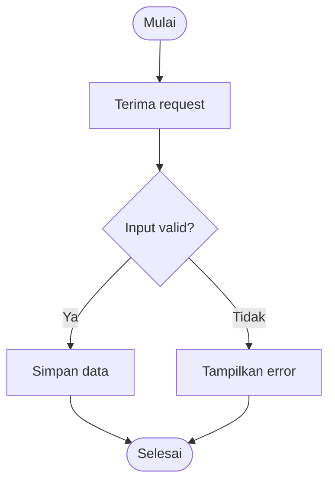

# Flowchart — spesifikasi MVP tanpa AI

Tanggal: 2026-10-08. Status: rancangan untuk implementasi; pengguna meminta specs + plan setelah menerima pendekatan tanpa AI. Dokumen ini memfinalkan draft pada path yang sama. Fitur belum diimplementasikan.

## 1. Tujuan dan keputusan

Tambahkan Flowchart pada More Tools: teks langkah/kondisi sederhana → Mermaid → preview → elemen native editable pada canvas. MVP berjalan lokal tanpa API key, model bahasa, MaPic, atau endpoint baru. Parser memakai grammar eksplisit; paragraf bebas tidak ditafsirkan otomatis. Branch implementasi yang diusulkan: `feat/flowchart`. Tugas dokumentasi ini tidak menjalankan implementasi.

## 2. Stack dan integrasi editor

- React/TypeScript, Excalidraw 0.18.1, CSS dan modul bahasa yang sudah ada.
- Converter `@excalidraw/mermaid-to-excalidraw` 2.2.2 dan Mermaid 11.17.2 sudah tersedia secara transitif pada instalasi/lockfile yang diperiksa. Deklarasikan dependency langsung dengan pin sama saat implementasi; jangan upgrade dependency lain.
- `parseMermaidToExcalidraw` mengembalikan skeleton/optional files. Normalisasi skeleton dengan `convertToExcalidrawElements` sebelum masuk API editor.
- Gunakan ekspor publik `TTDDialogTrigger` berlabel Flowchart dan ikon diagram untuk menempatkan entry di More Tools. Versi editor ini menambahkan badge AI secara tetap; sembunyikan hanya badge pada entry dengan marker CSS milik Inkspire. Tidak ada modifikasi vendor atau penyisipan DOM manual.
- Adapter `Editor.onChange` menangkap `openDialog: ttd/text-to-diagram` dan `ttd/mermaid`, menutup dialog native tanpa undo, lalu membuka dialog Inkspire pada tab yang sesuai. Entry Mermaid native memakai validator yang sama. Guard command palette lama tetap dipertahankan.
- Import converter native mungkin mulai saat state ttd berubah; import tersebut lokal. Uji runtime memastikan dialog native tidak tertinggal, callback tidak berulang, dan insertion native tidak bypass validator. Config `aiEnabled` adalah detail editor, bukan tanda bahwa Flowchart memakai layanan AI.

## 3. UI dan interaksi

More Tools → Flowchart → tab Teks / Mermaid → Buat preview → tinjau → Tambahkan ke canvas.

Dialog mengikuti paper/ink/vermilion, font lokal, light/dark, Indonesia/English. Desktop memakai input dan preview berdampingan; mobile satu kolom, scroll di dialog, tanpa overflow horizontal. Nama aksesibel Flowchart; fokus awal input; Escape/tombol tutup; fokus kembali ke pemicu More Tools. Keystroke textarea tidak menjalankan shortcut drawing. Workspace shortcuts yang dapat membuka dialog lain dibatasi ketika Flowchart modal aktif, tanpa mengubah perilaku shortcut saat modal tertutup.

Tab Teks: textarea, tombol contoh, bantuan grammar dan arah TD/LR. Tab Mermaid: textarea subset yang didukung. Gunakan kode Mermaid menyalin output teks ke tab Mermaid; teks asal tetap tersedia. Tidak ada konversi Mermaid kembali ke teks. Kode kanonik dapat disalin; jika clipboard unavailable, kode tetap dapat dipilih manual. Bahasa UI tidak mengubah user content.

Preview dirender dengan export native Excalidraw dari elemen hasil converter, bukan raw SVG/HTML dari input. Buat preview eksplisit, tanpa conversion setiap ketikan. Tambahkan hanya aktif untuk hasil sukses dari input/tab/arah/workspace yang masih sama. Edit input langsung menginvalidasi preview. Loading, error, warning memakai live region. Closing mempertahankan input dalam memori halaman, membuang preview, dan menolak hasil async terlambat.

## 4. Grammar teks

### Langkah dan kondisi

Baris tanpa indentasi berisi langkah atau rantai `->` / `→`. Sebelum kondisi, baris langkah berurutan tersambung otomatis. Baris kosong diabaikan. Tab ditolak; cabang memakai tepat dua spasi. Keyword Indonesia/English dikenali terlepas dari bahasa UI.

```text
Mulai
Terima request
Jika input valid?:
  Ya -> Simpan data -> Selesai
  Tidak -> Tampilkan error -> Selesai
```

```text
Start -> Receive request
If input valid?:
  Yes -> Save data -> End
  No -> Show error -> End
```

Mulai/Start dan Selesai/End menjadi terminal; label lain proses. Header `Jika <kondisi>:` / `If <condition>:` menjadi decision dengan label kondisi tanpa keyword/colon; tanda tanya opsional. Decision teks harus memiliki tepat satu Ya/Yes dan satu Tidak/No. Cabang kosong/berulang/di luar blok, nested indentation, atau kondisi tanpa dua cabang adalah error bernomor baris.

### Merge, referensi, loop

Setelah blok kondisi tidak ada merge tail cabang implisit. Blok/baris baru memulai rantai sendiri. Label identik setelah NFC, trim, dan pemadatan spasi mengidentifikasi node sama, dengan perbandingan case-sensitive. Dua proses berbeda harus memakai label berbeda. Label terminal Indonesia/English tidak otomatis digabung.

`@<label>` merujuk node yang didefinisikan di bagian mana pun pada input dan hanya boleh menjadi token terakhir rantai. Referensi maju diselesaikan setelah seluruh input; target tak dikenal error, bukan node baru. Banyak decision ditulis sebagai blok datar dan dihubungkan dengan referensi ke label kondisi.

```text
Mulai -> Ambil request
Jika request valid?:
  Ya -> Simpan data -> Selesai
  Tidak -> Tampilkan error -> @Ambil request
```

Loop eksplisit/merge diperbolehkan. Parser tidak menciptakan proses/cabang/retry/terminal yang tidak ditulis. Separator, newline, dan prefix @ tidak tersedia sebagai label literal pada tab Teks.

## 5. Subset Mermaid

Terima header `flowchart TD/LR` atau `graph TD/LR`; TB dinormalisasi TD. Setiap baris berisi deklarasi node atau rantai edge. ID berupa huruf ASCII diikuti huruf/angka/underscore. Node dapat didefinisikan inline atau pada baris lain; semua referensi harus mempunyai definisi. Definisi ulang dengan label/bentuk berbeda ditolak.

| Bentuk | Sintaks |
| --- | --- |
| Proses | `A["Label"]`, `A[Label]` |
| Decision | `B{"Kondisi?"}`, `B{Kondisi?}` |
| Terminal | `C(["Selesai"])`, `C([Selesai])`, `C("Selesai")`, `C(Selesai)` |
| Edge | `A --> B`, `A -->\|Ya\| B` |



Parser subset menghasilkan graph yang sama dengan parser teks, kemudian serializer menghasilkan Mermaid kanonik. Input asli tidak langsung dirender. Numeric entity desimal dan #quot; dikenali pada label, lalu di-encode ulang. Semicolon antar statement, comments, subgraph, styles/classes, click/link/callback, frontmatter/init, HTML/markdown labels, image/icon, shape syntax @{}, dan diagram lain ditolak dengan alasan; jangan membuang statement diam-diam atau memasukkan image fallback.

## 6. Graph, limits, security

Kontrak graph: direction, node ID/kind/label/baris, edge from/to/label/baris, warning berkode/baris. ID graph kanonik stabil; ID canvas baru diregenerasi per insertion agar diagram ganda tidak collision.

| Batas | Nilai |
| --- | --- |
| Input tiap tab | 8.000 UTF-16 code units |
| Baris nonkosong | 200 |
| Node / edge | 50 / 100 |
| Label node/edge | 120 code units |
| Mermaid kanonik | 64.000 code units |
| Elemen native hasil converter | 350 |

Empty input, grammar invalid, target tak dikenal, konflik definisi, dan limit memblokir preview. Warning nonblocking: tidak ada terminal awal; node tak terjangkau dari terminal awal; decision Mermaid tanpa dua cabang berlabel berbeda; proses nonterminal tanpa edge keluar. Cycle/self-loop tidak otomatis dianggap error. Pemeriksaan struktur tidak membuktikan kebenaran logika engineering.

Serializer memakai ID internal dan entity escaping, bukan menyisipkan label sebagai statement. HTML/markdown aktif ditolak setelah decoding; URL literal tetap teks dan tidak diaktifkan. Converter diberi config limit. Wrapper 2.2.2 tidak mendeklarasikan securityLevel/htmlLabels; jangan menganggap menambah field di luar tipe bekerja. Periksa default renderer aktual, lalu buktikan strict rendering/no remote loads lewat adversarial E2E. Hasil dengan files, image/iframe/embeddable, link, geometry nonfinite, atau tipe di luar rectangle/diamond/ellipse/text/arrow/line ditolak sebelum preview.

## 7. Lifecycle, insertion, storage

Controller milik App; dialog adalah view. Input/tab/arah hanya disimpan dalam memori halaman dan bertahan saat closing. Tidak menambah draft store/format workspace.

useWorkspace mengekspos workspaceId reaktif sebagai mirror identity ref sehingga replacement bernama sama tetap menginvalidasi preview. Identity ref tetap menjadi sumber pemeriksaan terakhir. Setiap conversion membawa token revision, workspace ID, dan editor API. Hanya hasil terbaru yang masih valid boleh menjadi preview. Edit input/tab/arah, closing, unmount, atau replacement workspace menginvalidasi token. Kerja lokal lama boleh selesai, tetapi hasil tidak dipublikasikan. Satu conversion aktif; Buat preview disabled selama kerja aktif. Closing tidak diklaim membatalkan computation.

Workspace berganti: input tetap, preview dibuang, pengguna diminta Buat preview lagi. Bahasa/tema tidak mereset input/canvas; preview dapat dirender kembali untuk tema tanpa mengubah graph.

Insertion memeriksa workspace/API/revision lagi, normalisasi ulang skeleton untuk ID/binding baru, offset semua elemen ke pusat viewport, group/pilih elemen baru, append ke scene termasuk deleted elements, dan satu updateScene dengan CaptureUpdateAction.IMMEDIATELY. Tidak reset scene/history, tidak scale font/node secara sepihak, tidak mengganti diagram lama. Double click dicegah; preview dikonsumsi sekali dan dialog ditutup setelah sukses.

Metadata pada satu anchor: `customData.inkspireFlowchart = { schemaVersion: 1, diagramId, sourceMermaid, inputMode }`. Source adalah snapshot saat insertion; edit canvas tidak menyinkronkan metadata. Tidak menaruh source pada setiap node atau menjalankan metadata sebagai kode. Draft IndexedDB/file .excalidraw mempertahankan elemen/metadata melalui serialization native. Source dapat disalin sebelum insertion; belum ada reopen editor dari metadata atau download MMD khusus.

## 8. Struktur implementasi

| File baru | Pemilik tanggung jawab |
| --- | --- |
| `src/features/flowchart/model.ts` | Kontrak graph/limits/error/builder/warnings |
| `src/features/flowchart/text.ts` | Grammar langkah/kondisi/ref |
| `src/features/flowchart/mermaid.ts` | Parser subset dan serializer |
| `src/features/flowchart/convert.ts` | Lazy converter, validasi output, blob preview |
| `src/features/flowchart/insert.ts` | IDs/bindings/posisi/group/metadata/history |
| `src/features/flowchart/useFlowchart.ts` | Input/state/invalidation/URL cleanup |
| `src/features/flowchart/FlowchartDialog.tsx` | Dialog/tab/preview/warning/copy/fokus |
| `src/features/flowchart/messages.ts` | Pesan error/warning Indonesia/English |
| `tests/flowchart-model.test.ts` | Graph/limits/warnings |
| `tests/flowchart-text.test.ts` | Grammar/merge/loop/line errors |
| `tests/flowchart-mermaid.test.ts` | Subset/roundtrip/escaping/rejection |
| `tests/flowchart-insert.test.ts` | Append/group/history/metadata |
| `tests/flowchart.e2e.ts` | More Tools/preview/insertion/persistence/race |
| `tests/flowchart-security.e2e.ts` | Native-entry bypass/adversarial/request isolation |

File perubahan: package.json/lock, Editor.tsx, App.tsx, useWorkspace.ts, app.css, editor/messages.ts, WorkspaceActions.tsx untuk guard shortcut modal, dan core docs setelah fitur tersedia. Script notice yang ada dipakai untuk dependency runtime; jangan menulis ulang tanpa kebutuhan.

## 9. Acceptance

1. More Tools memiliki Flowchart tanpa badge AI; entry Mermaid menuju validator sama. Berfungsi tanpa env MaPic.
2. Contoh Indonesia/English menghasilkan proses/terminal/decision/cabang/merge/loop sesuai input.
3. Subset Mermaid diterima; unsupported/adversarial input dijelaskan dan tidak dirender sebelum validasi.
4. Canvas identik sampai Tambahkan; hasil native editable/grouped/binding konsisten, satu undo, dua insertion tidak collision.
5. Save/import/reload mempertahankan elemen, source snapshot, dan aset lama. Edit/move node mempertahankan konektor.
6. Input change/closing/superseded result/workspace change tidak menerbitkan preview basi. Object URL direvoke saat diganti/ditutup/unmount.
7. Keyboard/focus/Escape, light/dark, bahasa dan mobile tersedia; user source tidak diterjemahkan.
8. Tidak ada panggilan MaPic/model/cloud/CDN. Companion/env operator tidak diubah. Offline berarti aplikasi/aset tetap dilayani companion lokal; bukan PWA/service worker.

Jalankan typecheck/unit/build, targeted E2E dev dan compiled production, serta existing E2E untuk regression editor/workspace/AI/theme/language. Semua suite memakai mock terisolasi; tidak ada GPU nyata. Plan lokal: `docs/superpowers/plans/2026-10-08-flowchart.md`, dikecualikan dari Git.

## 10. Di luar scope

AI/paragraf bebas, backend model, nested indentation, seluruh sintaks Mermaid umum, jenis diagram lain, cloud/gallery/many drafts, source-canvas sync, replace/regenerate diagram lama, dan auto-layout ulang objek yang telah diedit.

## Referensi

- [Mermaid flowchart syntax](https://mermaid.js.org/syntax/flowchart.html)
- [Mermaid configuration](https://mermaid.js.org/config/configuration.html)
- [Converter Mermaid ke Excalidraw](https://github.com/excalidraw/mermaid-to-excalidraw)
- [Skeleton API](https://docs.excalidraw.com/docs/@excalidraw/excalidraw/api/excalidraw-element-skeleton)
- [Excalidraw API](https://docs.excalidraw.com/docs/@excalidraw/excalidraw/api/props/excalidraw-api)
