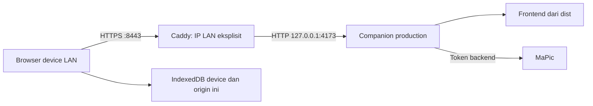

# Inkspire — LAN HTTPS Access Design

Tanggal: 2026-10-08. Status: desain disetujui; implementasi belum dimulai.

Branch: `feat/network-access`, dibuat dari `feat/flowchart` pada commit `69675444882b1159f58ae7c384d1a60b4823b403`. Integrasi branch ini bergantung pada perubahan Flowchart tersebut. Merge dan push merupakan tindakan terpisah.

## 1. Tujuan dan scope

Pengguna membuka Inkspire dari browser di device lain pada Wi-Fi/LAN yang sama melalui `https://<IP-LAN-host>:8443`. Satu host menjalankan companion production dan Caddy. Browser setiap device tetap memiliki canvas/draft sendiri; akses bersama ke host tidak berarti collaboration atau sinkronisasi data.

Pengguna telah memilih rancangan Caddy dan meminta specs + plan. Tahap dokumentasi ini tidak mengubah konfigurasi app, menjalankan proxy LAN, memasang Caddy, memasang sertifikat, atau melakukan generation MaPic nyata.

MVP mendukung IPv4 privat RFC 1918 yang terpasang pada interface host: `10.0.0.0/8`, `172.16.0.0/12`, dan `192.168.0.0/16`. IPv6, hostname/DNS, alamat publik, tunnel Internet, akun, collaboration, dan auto-start service berada di luar scope.

## 2. Alasan HTTPS dan model jaringan

Frontend memakai `crypto.randomUUID()` dan `crypto.subtle.digest()`. Browser membutuhkan secure context; HTTP ke IP LAN tidak memperoleh pengecualian localhost. HTTPS dengan CA yang dipercaya device menjadi alur utama, tanpa instruksi melewati warning browser atau mematikan pemeriksaan sertifikat. Referensi: [MDN secure contexts](https://developer.mozilla.org/en-US/docs/Web/Security/Defenses/Secure_Contexts), [Crypto.randomUUID](https://developer.mozilla.org/en-US/docs/Web/API/Crypto/randomUUID).



Companion selalu bind `127.0.0.1`, termasuk ketika mode LAN aktif. Caddy merupakan satu-satunya listener LAN. Tidak ada `0.0.0.0`, wildcard host, atau listener baru pada Vite. Mode development tetap localhost; mode LAN memakai hasil `npm run build`.

LAN menggunakan satu canonical origin. Dalam mode LAN, host juga membuka URL HTTPS yang sama; URL HTTP localhost bukan origin alternatif yang diizinkan. Ketika konfigurasi LAN dihapus, perilaku localhost kembali seperti sekarang.

## 3. Kontrak konfigurasi

Tambahkan satu variable backend opsional:

```dotenv
INKSPIRE_PUBLIC_ORIGIN=
```

Kosong/tidak diisi berarti localhost. Contoh nilai LAN: `https://192.168.1.20:8443`. `INKSPIRE_PORT` tetap port upstream companion, default `4173`.

Aturan parser:

1. Hanya HTTPS, IPv4 privat dotted decimal canonical, dan port eksplisit `1024..65535`.
2. Tolak credential, query, fragment, path selain `/`, whitespace, wildcard, IPv6, localhost, IP publik, serta bentuk IP hexadecimal/octal atau singkat.
3. Satu trailing slash dapat diterima dan dinormalisasi menjadi `URL.origin`. Port tidak boleh memiliki leading zero.
4. Nilai LAN bersama `--dev` gagal startup dengan pesan konfigurasi singkat, tanpa mencetak environment, token, atau stack.
5. Companion memperoleh origin dari konfigurasi valid; `startApp()` tidak menimpanya dengan alamat HTTP upstream setelah `listen()`.
6. Default localhost tetap memperoleh port aktual dari `server.address()`, termasuk fixture `port: 0`.

`AppConfig.origin` tetap field canonical origin; tidak perlu field duplikat atau perubahan kontrak generation frontend. Parser berada di `server/origin.ts`, dipakai oleh `readConfig()` dan renderer konfigurasi Caddy. Semua API browser tetap memakai URL relatif.

## 4. Caddy dan file lokal

Generator mengambil canonical origin dan port upstream dari konfigurasi backend yang sama. Pengguna tidak perlu menjaga dua variable IP yang terpisah. Generator memeriksa bahwa IP tujuan benar-benar tercantum pada interface IPv4 host. Tidak ada pemilihan interface otomatis.

Contoh konfigurasi yang dihasilkan, dengan path storage absolut yang dihitung dari root proyek:

```caddyfile
{
    admin off
    persist_config off
    skip_install_trust
    auto_https disable_redirects
    storage file_system "/absolute/project/.inkspire-lan/data"
    servers {
        protocols h1 h2
    }
}

https://192.168.1.20:8443 {
    bind 192.168.1.20
    tls internal
    reverse_proxy 127.0.0.1:4173
}
```

Konfigurasi menggunakan CA internal Caddy, tanpa ACME publik. Redirect HTTP otomatis dimatikan agar tidak membuat listener tambahan port 80. HTTP/3 tidak diaktifkan sehingga alur firewall hanya membutuhkan TCP pada port HTTPS yang dipilih. Admin API dimatikan; perubahan konfigurasi dilakukan dengan stop/start proses foreground, bukan `caddy reload` atau `caddy stop` melalui admin API.

Caddy meneruskan Host dan Origin browser ke upstream HTTP. Jangan menulis ulang keduanya menjadi localhost. Jangan menambahkan CORS wildcard, daftar origin dinamis, header trust, retry generation, atau timeout proxy pendek yang memutus request MaPic yang sah.

File runtime:

| Lokasi | Isi | Perlakuan |
| --- | --- | --- |
| `.inkspire-lan/Caddyfile` | Konfigurasi host aktual | Generated, ignored, mode file `0600` pada POSIX |
| `.inkspire-lan/data/` | PKI dan storage Caddy | Ignored, directory lokal `0700` pada POSIX |
| `.inkspire-lan/data/pki/authorities/local/root.crt` | Sertifikat root CA publik | Hanya file ini yang dibagikan ke device untuk trust |
| File `.key` dan data PKI lain | Private key CA/sertifikat | Tetap pada host; tidak di-export atau disajikan ke browser |

Root folder ditambahkan ke `.gitignore` sebelum commit implementation. Semua file tersebut berada di luar `dist`/`public`. Guard web serving tetap menolak dot path, environment, traversal, dan folder source. File root CA tidak dibuat menjadi endpoint download app.

Referensi konfigurasi: [Caddy global options](https://caddyserver.com/docs/caddyfile/options), [bind](https://caddyserver.com/docs/caddyfile/directives/bind), [tls internal](https://caddyserver.com/docs/caddyfile/directives/tls), [reverse_proxy](https://caddyserver.com/docs/caddyfile/directives/reverse_proxy), [CLI](https://caddyserver.com/docs/command-line).

## 5. Script dan alur operator

Script yang direncanakan:

| Script | Perilaku |
| --- | --- |
| `npm run lan:config` | Membaca konfigurasi backend, memvalidasi IP interface, menulis Caddyfile; tidak bind port atau memasang trust |
| `npm run lan:serve` | Menulis ulang konfigurasi dari nilai terbaru, menjalankan `caddy run` foreground, meneruskan penghentian proses |
| `npm run test:lan` | Tes proxy HTTPS Caddy terisolasi, loopback, menggunakan mock MaPic dan CA tes |

CLI tersedia pada hasil build companion, menggunakan `node --env-file-if-exists=.env`. Caddy merupakan executable eksternal dengan modul standar; tidak menambah dependency frontend atau plugin Caddy. Versi executable yang dipakai harus dicatat saat verifikasi. Installer global atau OS trust tidak dijalankan oleh script.

Urutan operator: pilih IP interface Wi-Fi/Ethernet yang aktif → isi origin di `.env` → build → generate/validate Caddyfile → jalankan companion dan proxy di dua terminal → salin `root.crt` → pasang trust pada device yang akan mengakses → buka URL HTTPS. Bila firewall meminta izin, batasi sesuai jaringan lokal dan port TCP tersebut. Gunakan reservasi DHCP untuk mempertahankan origin.

Caddyfile invalid, IP tidak terpasang, binary tidak tersedia, atau kegagalan filesystem menghasilkan exit nonzero dan pesan ringkas. Tidak ada fallback diam-diam ke wildcard, HTTP LAN, port lain, atau Caddy sistem.

## 6. Trust, akses, dan data

Trust sertifikat dilakukan manual oleh operator. `skip_install_trust` mencegah Caddy mencoba memasang CA pada trust store host. Dokumentasi memberi lokasi root certificate, fingerprint SHA-256, dan verifikasi HTTPS tanpa bypass. Device harus mempercayai CA sesuai sistem/browser-nya; keberhasilan Node/curl bukan bukti trust browser device.

Semua device yang dapat menjangkau listener dan membuka origin app dapat menggunakan API generation. Guard origin bukan login atau identitas user. Mode ini ditujukan untuk LAN tepercaya; authentication publik tidak ditambahkan pada MVP ini.

Token dan URL MaPic tetap backend. Caddy child menerima environment terbatas, tanpa `MAPIC_SERVICE_TOKEN` atau environment operator lengkap. Tidak ada endpoint konfigurasi/PKI, request-body logging, atau token di bundle browser.

Satu request generation aktif berlaku global per companion, termasuk request dari browser berbeda. Request kedua menerima `409 REQUEST_ACTIVE`; disconnect browser tidak membuka slot terlalu awal. Tidak ada retry otomatis.

Draft tetap IndexedDB per browser profile, device, dan origin. `http://127.0.0.1:4173` dan `https://192.168.1.20:8443` memiliki draft berbeda. Perubahan IP/port juga menciptakan origin storage lain. Draft lama tidak dihapus dan tidak dipindahkan otomatis; gunakan export/import `.excalidraw` sebelum mengganti origin. Preview AI tetap dalam memori; gambar persisten setelah insertion mengikuti draft/file browser tersebut.

## 7. Validasi request yang dipertahankan

- Host harus tepat canonical host:port untuk frontend dan API.
- API generation harus memenuhi Origin yang tepat, `X-Inkspire-Client: 1`, method/content type, fetch-site, serta validasi body/gambar yang sudah ada.
- `Forwarded`, `X-Forwarded-Host`, dan `X-Forwarded-Proto` tidak menggantikan keputusan origin backend. Header tersebut tidak membuat request Host/Origin salah menjadi valid.
- WebSocket upgrade tidak memperoleh whitelist tambahan; production tidak memerlukan HMR LAN.
- Payload/error tidak memuat credential MaPic, certificate key, atau stack internal.

## 8. Pengujian dan acceptance

| Gate | Bukti yang diperlukan |
| --- | --- |
| Parser | Default localhost, seluruh range IPv4 privat, batas port, canonicalization, invalid values, dan penolakan LAN+dev |
| Companion | Listener loopback, port ephemeral default, canonical HTTPS dipertahankan, Host/Origin salah ditolak sebelum mock |
| Shared generation | Dua client ke companion sama: request pertama sukses, kedua 409, jumlah call mock tidak bertambah |
| Renderer/CLI | Bind eksplisit, upstream port tepat, internal TLS, admin/redirect/trust disabled, secrets tidak ikut file/child env, IP harus terpasang |
| Caddy nyata terisolasi | Config adapted dan validated; proxy loopback dengan TLS chain/hostname diperiksa menggunakan root tes, CA salah ditolak, Host/Origin salah ditolak, mock generation sukses |
| Regression | Typecheck, unit/HTTP, build, E2E development dan compiled production memakai mock |
| Device LAN nyata | Setelah CA dipercaya: tidak ada warning TLS, `isSecureContext`, UUID/hash, canvas, autosave/reload, file round trip, Flowchart, bahasa/tema, serta AI dengan mock berjalan |

Tes Caddy otomatis memakai fixture hostname `localhost` yang hanya bind loopback, CA/storage temporary, port terisolasi, dan environment eksplisit tanpa `.env`. Fixture mengubah site/bind untuk menghindari aktivasi listener LAN selama suite. Tes parser/renderer dan HTTP companion secara terpisah mencakup IP LAN canonical. Tidak ada modifikasi trust store sistem, `curl -k`, `ignoreHTTPSErrors`, atau global certificate bypass.

Browser regression biasa berjalan pada harness yang sudah ada. Tes proxy otomatis tidak membuktikan bahwa CA sudah dipercaya pada device nyata. Sign-off device dilakukan terpisah dan dicatat sebagai pending bila belum diuji; jangan mengklaim akses LAN siap penuh hanya karena suite loopback lulus. Generation pada device memakai backend mock untuk acceptance; tes GPU nyata memerlukan instruksi pengguna tersendiri.

## 9. Rollback dan dokumentasi

Stop proses proxy dan companion yang dijalankan untuk LAN, kosongkan `INKSPIRE_PUBLIC_ORIGIN`, lalu jalankan companion localhost kembali. Draft setiap origin tetap tersimpan di browser. Jangan menghapus PKI atau mengganti CA otomatis; penghapusan CA memerlukan trust ulang pada device. Trust dapat dicabut manual bila penggunaan LAN dihentikan permanen.

Implementation memperbarui README, ARCHITECTURE, WORKFLOW, CHANGELOG, dan AGENTS agar menjelaskan optional LAN production, origin storage, shared generation, sertifikat, dan rollback. `docs/verification.md` mencatat versi Caddy, gate otomatis, serta sign-off device secara terpisah. Plan disimpan lokal dan tidak di-commit; spesifikasi ini boleh di-commit dengan identitas owner.
